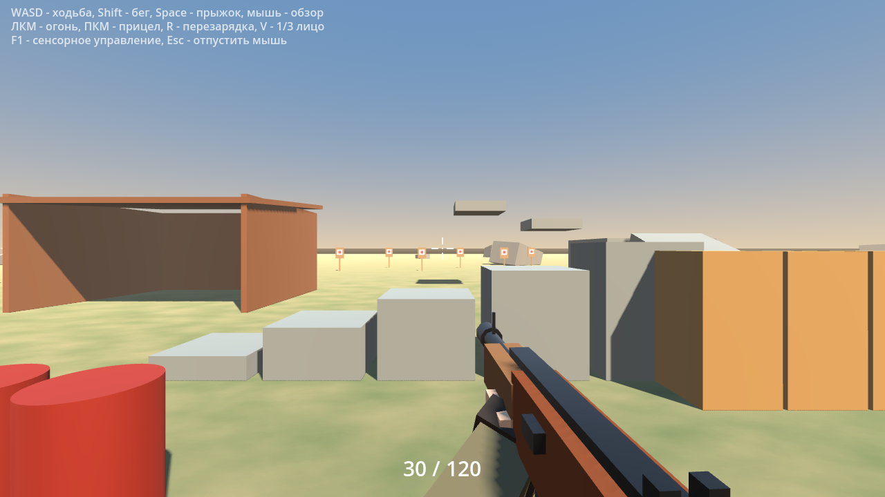
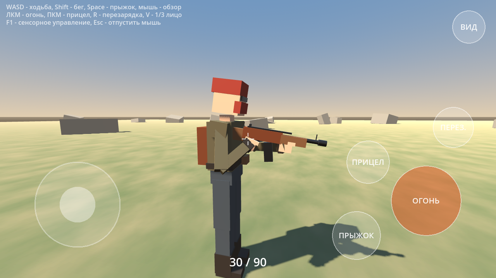
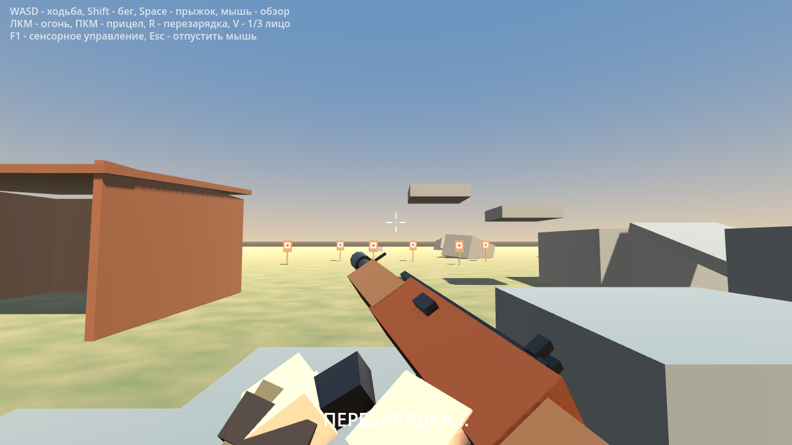
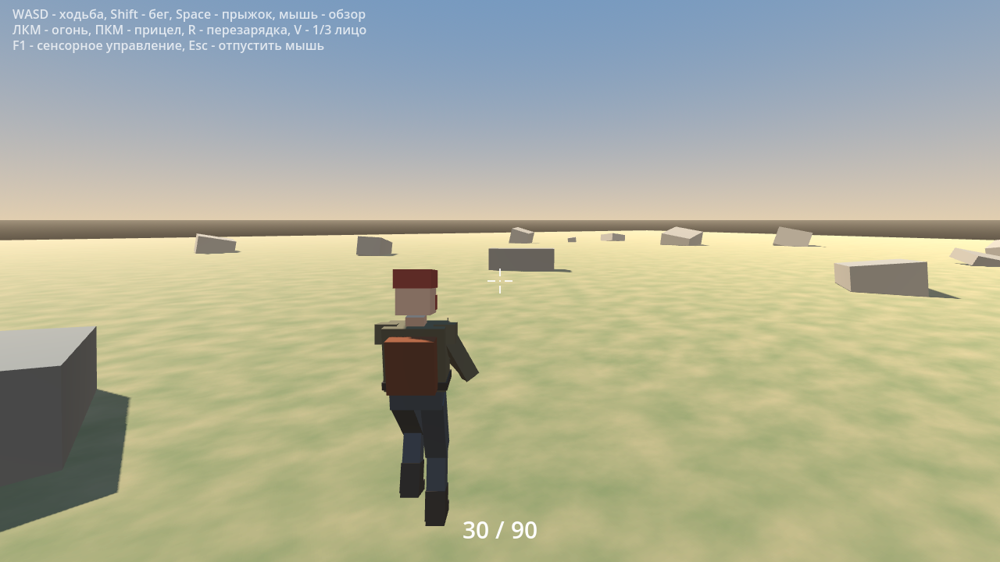

# Scrap Survival Shooter (Godot 4.3)

Прототип шутера на выживание для Godot 4.3: вид от 1-го и 3-го лица, мобильное управление, оружие, руки, анимации, звуки.

| От 1-го лица | Вид сбоку + сенсорное управление |
|---|---|
|  |  |
| **Перезарядка** | **Прыжок, 3-е лицо** |
|  |  |

## Что есть

- **Руки совпадают с моделью персонажа.** Сделано по схеме «true first person»: камера стоит в голове персонажа, голова скрыта только для камеры 1-го лица, а руки — это руки самой модели. Они держат оружие через IK (обратную кинематику), поэтому в 1-м и 3-м лице это одни и те же руки.
- **1-е и 3-е лицо** переключаются кнопкой `V` или «ВИД». У камеры 3-го лица есть SpringArm, она не проходит сквозь стены.
- **Мобильное управление:** плавающий джойстик (левая половина экрана), обзор свайпом (правая половина), кнопки ОГОНЬ / ПРЫЖОК / ПЕРЕЗ. / ПРИЦЕЛ / ВИД. Если вести пальцем по кнопке ОГОНЬ, можно стрелять и одновременно поворачивать камеру.
- **ПК:** WASD, мышь, ЛКМ — огонь, ПКМ — прицел, R — перезарядка, Space — прыжок, Shift — бег, V — вид, F1 — включить сенсорные кнопки, Esc — отпустить мышь.
- **Анимации:**
  - ходьба, бег (оружие опускается), прыжок и приземление, покачивание при ходьбе;
  - отдача, вспышка из ствола, трассеры;
  - прицеливание через мушку;
  - перезарядка: магазин вынимается и падает на землю как физический объект, рука достаёт новый магазин из подсумка, вставляет его и передёргивает затвор.
- **Звуки** генерируются кодом (`scripts/sfx.gd`), внешние файлы не нужны: выстрел, щелчок пустого магазина, магазин вынут/вставлен, затвор, шаги, прыжок, приземление, попадание.
- **Тестовая карта:** камни, хижина из металлолома, рампа и платформы для прыжков, ящики и бочки с физикой (реагируют на пули), тир с падающими мишенями.

## Как запустить

1. Скачай [Godot 4.3](https://godotengine.org/download).
2. Нажми Import и выбери `project.godot`.
3. Нажми F5.

### Сборка под Android

1. В Godot: Editor → Manage Export Templates → Download.
2. Укажи путь к Android SDK в Editor Settings → Export → Android.
3. Project → Export → Add → Android → Export Project → `.apk`.

На телефоне сенсорные кнопки включаются сами.

## Структура

| Файл | Что делает |
|---|---|
| `scripts/main.gd` | карта, свет, небо, привязка клавиш, создание игрока и интерфейса |
| `scripts/player.gd` | движение, прыжок, бег, камеры, стрельба, перезарядка, звуки, эффекты |
| `scripts/rig.gd` | модель персонажа и оружия, IK рук, анимации ног, оружия и перезарядки |
| `scripts/touch_controls.gd` | джойстик и кнопки для телефона |
| `scripts/hud.gd` | прицел, патроны, маркер попадания |
| `scripts/sfx.gd` | генерация звуков |
| `scripts/target.gd` | падающие мишени |

## Как поставить свои модели и звуки

- **Оружие:** импортируй `.glb` или `.fbx`, добавь его в `weapon` в `rig.gd` вместо коробок и передвинь маркеры `GripR`, `GripL`, `MagWell`, `Bolt`, `Muzzle` на свою модель. Руки сами встанут на новые точки хвата.
- **Персонаж:** замени коробки в `_build_body()` и `_build_upper()` на свою модель. Для скелетной модели (например, с [Mixamo](https://www.mixamo.com)) можно взять `SkeletonIK3D` вместо самописного IK.
- **Звуки:** в `player.gd` в `_add_sound(...)` замени `Sfx.gunshot()` и остальные на `load("res://sounds/shot.ogg")`.

> Модели, текстуры и звуки из игры Rust (Facepunch) сюда не включены: это чужие защищённые ассеты, распространять их в репозитории нельзя. Бесплатные ассеты с открытой лицензией (CC0) есть, например, на [Quaternius](https://quaternius.com), [Kenney](https://kenney.nl) и [Poly Pizza](https://poly.pizza).
